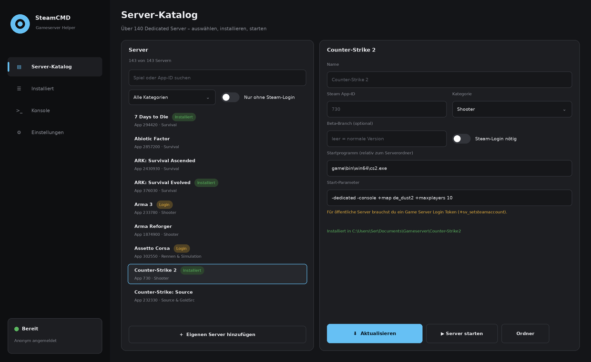

# SteamCMD Helper

von **[FGSeRaser](https://github.com/FGSeRaser)**

Windows-Tool, um Dedicated Server mit SteamCMD zu installieren, zu aktualisieren und zu starten – ohne Kommandozeile.



## Download

Die fertige EXE gibt es unter [Releases](https://github.com/FGSeRaser/SteamCMD-Helper/releases).

## Funktionen

- **Server-Katalog** mit über 170 Dedicated Servern (Counter-Strike 2, Rust, ARK, Valheim, Palworld, SCUM, Enshrouded, ASKA, Return to Moria, VEIN, Sunkenland, Satisfactory, Project Zomboid, Source-Spiele und viele mehr), filterbar nach Kategorie, Suche und „ohne Login“.
- **Jeder andere Server per App-ID (experimentell):** App-ID eingeben → „Bei Steam prüfen“. SteamCMD liest Name, Windows-Unterstützung, Startprogramm und Parameter direkt von Steam. Damit funktionieren auch ganz neue Server, die noch in keinem Katalog stehen.
- **Online-Katalog:** Beim Start lädt der Helper neue Server aus [`catalog.json`](catalog.json) in diesem Repository. Neue Server kommen so ohne Programm-Update dazu.
- **Startprogramm automatisch erkennen:** Nach der Installation wird das Server-Programm im Ordner gesucht (Button „Erkennen“ zeigt alle Kandidaten).
- **Lernt mit:** Meldet Steam „No subscription“, wird der Server automatisch als „Steam-Login nötig“ markiert.
- **Installieren und Aktualisieren** mit einem Klick, auch mehrere nacheinander („Alle aktualisieren“).
- **Konsole** mit Live-Ausgabe, Fortschrittsbalken und Eingabefeld für Steam-Guard-Codes.
- **Server starten** mit vorbelegten Startbefehlen für die bekanntesten Spiele; Startprogramm und Parameter sind pro Server anpassbar.
- **SteamCMD** wird bei Bedarf automatisch von Valve heruntergeladen.
- `.bat`-Skripte zum Aktualisieren und Starten erzeugen.

Das Steam-Passwort wird nie gespeichert. Nach dem ersten Login merkt sich SteamCMD die Anmeldung selbst.

## Neuen Server zum Online-Katalog hinzufügen

In `catalog.json` einen Eintrag in `servers` ergänzen:

```json
{ "name": "Mein Spiel", "appid": 1234560, "category": "Survival", "login": false,
  "exe": "MeinSpielServer.exe", "args": "-log", "note": "", "beta": "" }
```

Kategorien: `Shooter`, `Survival`, `Aufbau & Sandbox`, `Source & GoldSrc`, `Rennen & Simulation`, `Sonstige`.

## Quellen

App-IDs und Login-Pflicht stammen, wo vorhanden, aus den Configs von [LinuxGSM](https://github.com/GameServerManagers/LinuxGSM) und den [Pelican-Eggs](https://github.com/pelican-eggs/games-steamcmd).

## Bauen

`SteamCMD Helper.sln` in Visual Studio 2022 öffnen und starten (.NET Framework 4.8, keine NuGet-Pakete).
Einstellungen liegen unter `%AppData%\SteamCMD Helper\data.json`.

## Autor

Entwickelt von **FGSeRaser**. Weitere Projekte gibt es auf GitHub: [github.com/FGSeRaser](https://github.com/FGSeRaser)

Im Programm findest du den Link unten in der Seitenleiste („von FGSeRaser“).
